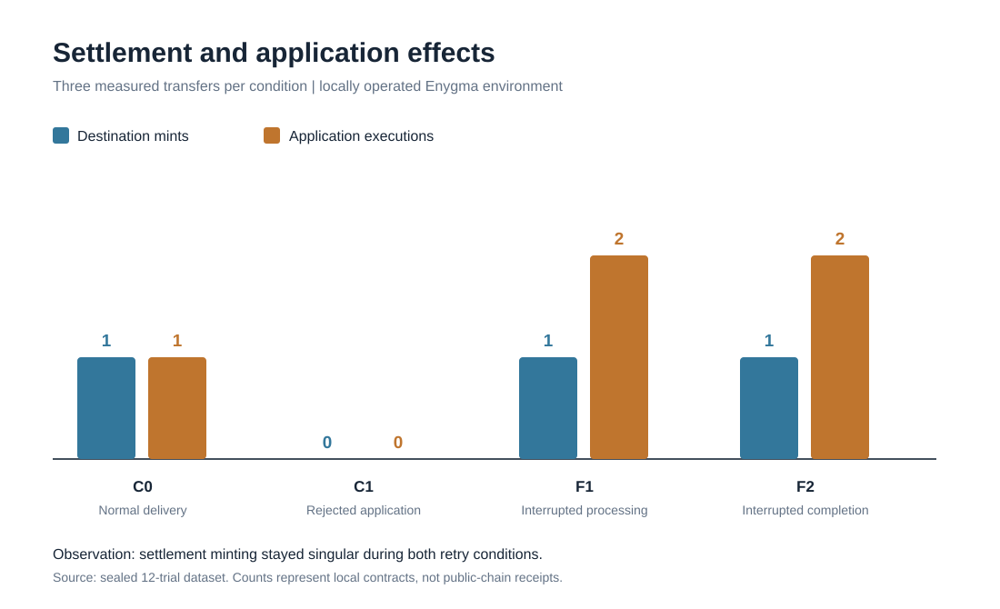

# Can a Cross-Chain Payment Settle Once but Execute an Application Twice?

**A controlled study of programmable transfer recovery in Rayls Enygma**

A token transfer can settle correctly while a separate application action is processed more than once. We tested that distinction in an isolated Rayls Enygma network using ordinary deliveries, rejected applications and two controlled receiver interruptions.

**Result:** Across six interrupted transfers, the destination token was minted once, but an approved non-idempotent application action executed twice. Three ordinary controls executed once. Three rejected-application controls were refunded, with no destination application effect. These are observations from our **operator-controlled local environment**, not proof of a production-network exploit.

## Why it matters

A financial application might interpret an approved transfer action as permission to issue a credit, change a record or grant an entitlement. Correct token-supply accounting alone does not establish that the related application action is processed exactly once across separate recovery transactions.

The research question is practical: **which part of the processing path prevents duplicate effects, and which part remains the application's responsibility?** The tested settlement reference prevented a second mint. Our deliberately non-idempotent observer did not prevent a second action.

## Measured results

| Condition | Transfers | Destination mints per transfer | Application effects per transfer | Source refunds |
| --- | ---: | ---: | ---: | ---: |
| Normal delivery | 3 | 1 | 1 | 0 |
| Rejected application | 3 | 0 | 0 | 3 |
| Interrupted destination processing | 3 | 1 | 2 | 0 |
| Interrupted completion | 3 | 1 | 2 | 0 |

Each transfer used a new logical payment identifier and a 0.1-token local research asset. The relevant source burn, destination supply, observer state and refunds were reconciled using historical local RPC state.

The exact interruption machinery is not published here while its security implications are assessed. The observed behavior and the boundaries of the evidence are published openly.

## Read the research

[Method, observations and interpretation](docs/Research.md) · [Evidence register and omissions](docs/Evidence-Register.md) · [Independent verification and limits](docs/Verification-Boundaries.md) · [Disclosure and scope](docs/Disclosure.md)

The [research page](index.html) offers a visual summary and the measured retry-interval chart.

## Inspect the evidence

This public package contains **12 historical-state records**, **51 unique local transaction observations**, the accompanying **51 saved root-reconstruction reports**, the derived measurement files, independent code tests and a completeness manifest. Each exposed trial artifact has an explicit path in the public evidence index.

Run on any computer with Python 3.10+:

    python3 -B scripts/check_evidence.py
    python3 -B scripts/check_release.py
    python3 -B scripts/verify_public_commitment.py

Use --online with the last command to query the public Rayls Testnet RPC directly. The GitHub Actions workflow also runs the checks on a separate hosted runner and performs contract-level and relayer-level tests against pinned official Rayls source.

**Important distinction:** Recomputing or checking saved local receipt/root data is not independent validation of those privately operated ledgers. The original network was run by the researcher. GitHub-hosted execution verifies the supplied code and archive, not independent blockchain consensus.

## Public evidence commitment

The final original archive's SHA-256 manifest digest was committed on Rayls **Public Testnet** in [transaction 0x397f1979a00ad430f1b925c62d3b14ced83eb294ebc775269865a38d87e855db](https://testnet-explorer.rayls.com/tx/0x397f1979a00ad430f1b925c62d3b14ced83eb294ebc775269865a38d87e855db), block **22,398,118**.

The committed digest is:

    3cf97ce8a4ea2f8b4248ea39e4b3f94b05abb96e8998ca9f7372d9c593859349

It timestamps the **post-experiment archive manifest**, not the original trial plan. It is not a public-chain Enygma settlement receipt and does not prove the truth of privately operated chain data.

## Source and reproducibility

- [Rayls Sovereign contracts](https://github.com/raylsnetwork/rayls-sovereign-contracts), pinned revision ed8863885c8ed5d5d317d47a34c063907192687a
- [Rayls Sovereign relayer](https://github.com/raylsnetwork/rayls-sovereign-relayer), pinned revision b01b427de4cfc2ac66e75eba0d5070b73a3b137c
- [How Enygma works](https://docs.rayls.com/docs/how-enygma-works)
- [Sending Enygma transactions](https://docs.rayls.com/docs/send-enygma-transactions)

On GitHub's separate runners, six contract tests, a native receiver test and byte-identical builds of both the normal and test-only instrumented relayers were executed against the pinned sources. These are **independent computational checks**; they are not a separately operated full three-chain deployment.

The original measurements used three trials per condition. A complete independently governed network replication has **not** been performed. The original plan was not independently timestamped before the initial measurements. Those limitations are part of the result, not hidden qualifications.

This research and its evidence are presented as an independent technical contribution. The security-relevant observation was also reported privately to Rayls maintainers; no maintainer determination or production-vulnerability confirmation is claimed.
