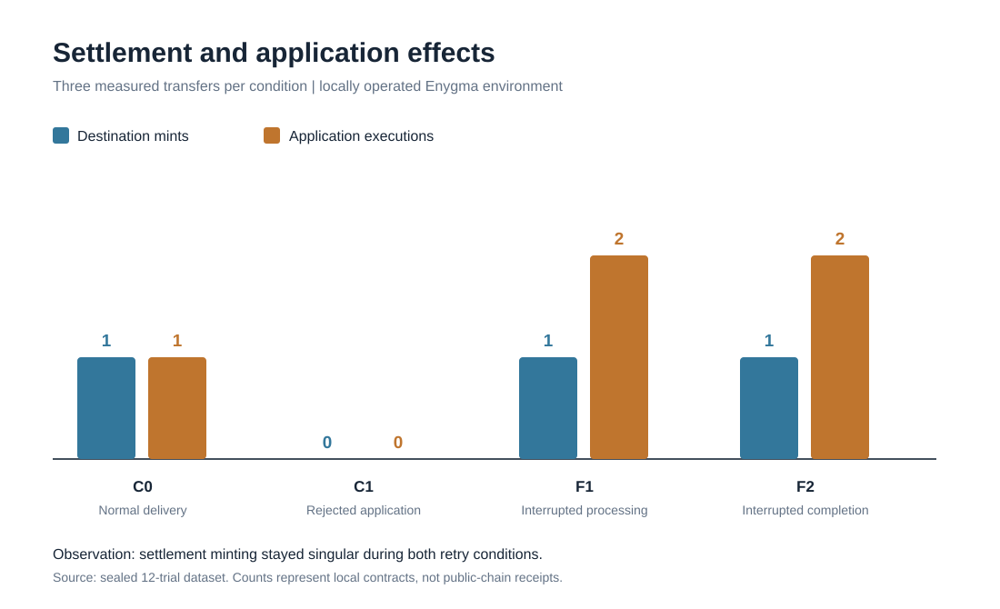
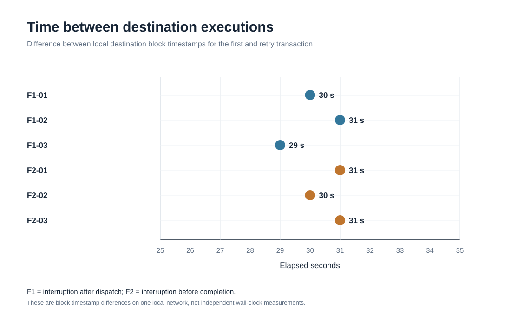

# Can a cross-chain payment settle once but execute an application twice?

## A controlled Rayls Enygma receiver-recovery experiment

Enygma moves tokens between Rayls Sovereign chains through a Private Network Hub. A programmable transfer can also carry approved contract calls for its destination. Within one destination transaction, minting and the approved calls succeed or revert together. That transaction-level atomicity does not itself establish exactly-once application execution across multiple transactions initiated by a recovering relayer.

This study tests that distinction in a controlled development network: if destination execution succeeds but the relayer is interrupted before it confirms completion, does recovery repeat the token mint, the application call, both, or neither? We do not assume that Rayls promises exactly-once application execution across retries.

## Network and experiment

Two local Sovereign chains and a local Private Network Hub were operated on a single research host, together with relayers, CTS services and a zero-knowledge proof service. Source was pinned to the following revisions:

| Component | Commit |
| --- | --- |
| Rayls Sovereign contracts | ed8863885c8ed5d5d317d47a34c063907192687a |
| Rayls Sovereign relayer | b01b427de4cfc2ac66e75eba0d5070b73a3b137c |

An approved destination application contract recorded a logical payment identifier and incremented a counter on each call. The contract deliberately did not suppress duplicate logical identifiers. This made application effects measurable independently of token minting.

The source sent 0.1 token per payment. Twelve distinct payments were assigned to four conditions, with three repetitions per condition. The trial schedule and inputs were fixed locally before execution, but no independent pre-experiment timestamp of the schedule exists.

| Condition | Purpose | Trials |
| --- | --- | --- |
| C0 — normal delivery | Establish successful settlement behavior | 3 |
| C1 — rejected application | Test complete refund and absence of destination effects | 3 |
| F1 — interrupted destination processing | Observe recovery after destination execution dispatch | 3 |
| F2 — interrupted completion | Observe recovery before the completion notification | 3 |

The destination relayer used the official opt-in test-only fault-injection build. Its running executable was verified against the corresponding locally compiled, pinned-source binary. The remaining relayer used the normal build. No mainnet or third-party production deployment was tested.

## Results

| Condition | Successful destination mint events per payment | Application effects per payment | Source compensation |
| --- | --- | --- | --- |
| C0 | 1 | 1 | Not required |
| C1 | 0 | 0 | 3 of 3 mined refunds |
| F1 | 1 | 2 | Not required |
| F2 | 1 | 2 | Not required |

The six fault trials produced two distinct successful destination program transactions for the same logical payment, using identical program calldata. The first destination execution increased token supply by 0.1 and called the observer once. A second destination execution incremented the observer again without a second token mint. The source and destination balances and supplies reconciled with one settlement per successful payment.

The three normal controls executed the application action once. All three deliberately rejected-program controls completed compensating source transactions, restored source balances and left destination application state unchanged.

These results support a specific local conclusion: under the instrumented receiver recovery paths, reference-ID protection prevented a repeated settlement mint, while the non-idempotent approved application action executed again. This does not prove double minting or a production-network exploit.

The graphics are generated directly from the sealed trial results and recorded block timestamps; the rendering script supports deterministic byte-for-byte verification.

## Evidence

Fifty-one saved local-chain transaction observations were re-queried from the running nodes. Transaction and receipt trie roots were recomputed against the corresponding locally returned block headers. This verifies coherence with the operator-controlled chain history, not independent network consensus.

The archive also contains twelve historical financial-state reconciliations, six one-shot intervention records, source refunds, native relayer and CTS observations, build provenance and an integrity manifest of 289 files. Five intentionally altered copies of evidence were rejected by the forensic verifier.

Checks on GitHub-hosted computers independently re-executed the archived-evidence audit and contract-level Solidity tests. A separate Go receiver-recovery test checked the pending-processing decision against pinned relayer code. The normal and instrumented relayer executables were also rebuilt byte-for-byte on a hosted runner using the original Go toolchain container. These tests and builds do not constitute a second live deployment of the full three-chain protocol.

The preserved evidence-manifest digest is:

3cf97ce8a4ea2f8b4248ea39e4b3f94b05abb96e8998ca9f7372d9c593859349

The digest was committed on Rayls Public Testnet in [transaction 0x397f1979a00ad430f1b925c62d3b14ced83eb294ebc775269865a38d87e855db](https://testnet-explorer.rayls.com/tx/0x397f1979a00ad430f1b925c62d3b14ced83eb294ebc775269865a38d87e855db), block 22,398,118 (November 4, 2026, 19:57:39 UTC). The successful, zero-value transaction includes the exact 32-byte manifest SHA-256 digest. The live public RPC confirmed the transaction, containing block and exact manifest digest. During the final online verification, the RPC did not return the historical receipt, so the public explorer supplied the separately queried successful transaction status. This is a post-experiment evidence integrity commitment: it does not validate private-chain payments or establish preregistration before the experiment.

## Application-level replay guard

A supplementary Solidity test, run on a separate GitHub-hosted machine, deployed an application variant that records each logical payment ID and performs its state change only on the first invocation. Two repeated dispatches then produced one token mint and one application effect. The same contract-level harness without this guard produced two application effects.

This is a practical, independently executed **code-level mitigation control**, not a thirteenth measured cross-chain trial or a fix to the relayer's recovery mechanism. It demonstrates the value of making approved destination application calls idempotent while the intended guarantees of the protocol itself are assessed.

## Interpretation and boundaries

Financial settlement idempotency and application idempotency are different properties. A developer implementing a state-changing application callable should not infer application-level replay protection solely from reference-ID checks on the settlement mint. Whether Rayls intends to guarantee application-level at-most-once execution across normal recovery is a specification question.

The experiment used a single operator-controlled network, test-only fault injection, a deliberately non-idempotent application contract and three repetitions per condition. We did not establish that an attacker can trigger the same sequence in a production deployment. A full independent multi-chain replication and third-party consensus attestation have not been completed.

The result was submitted privately for maintainer security assessment. Detailed reproduction steps are withheld while its implications are evaluated.

## Sources

- [How Enygma works](https://docs.rayls.com/docs/how-enygma-works)
- [Send Enygma transactions](https://docs.rayls.com/docs/send-enygma-transactions)
- [Rayls Sovereign contracts](https://github.com/raylsnetwork/rayls-sovereign-contracts)
- [Rayls Sovereign relayer](https://github.com/raylsnetwork/rayls-sovereign-relayer)
\n[Public evidence register](Evidence-Register.md) · [Verification boundaries](Verification-Boundaries.md) · [Release scope](Disclosure.md)\n